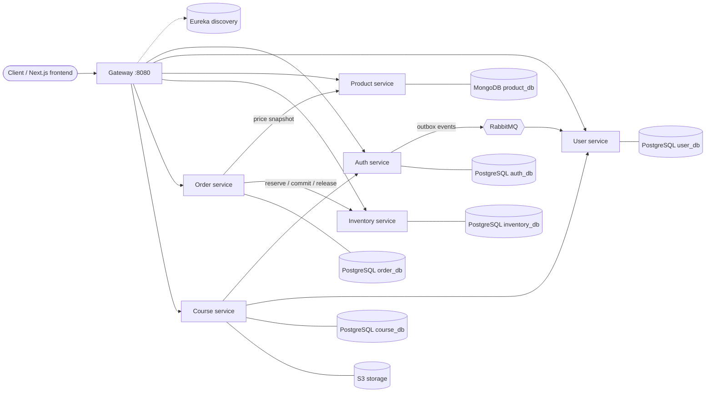

# E-Commerce & Learning Platform

[](https://github.com/abdullaabdullayev/e-commerce/actions/workflows/ci.yml)


A microservices backend for an online store combined with a learning platform (courses, lessons,
student points and parent access), built with **Spring Boot 3** and **Spring Cloud**.

## Highlights

- **API Gateway + service discovery**: all public traffic enters through Spring Cloud Gateway; services register in Eureka and call each other with OpenFeign / load-balanced clients.
- **Security**: JWT access tokens, refresh tokens stored as hashes, logout, login rate limiting, account deactivation, role-based access (`CUSTOMER`, `ADMIN`, `TEACHER`, `STUDENT`, `PARENT`), service-to-service keys for `/internal/**` endpoints.
- **Reliable messaging**: registration events are written to a **transactional outbox** and relayed to **RabbitMQ**; consumers retry and park failures in a **dead-letter queue** that admins can replay.
- **Checkout flow**: order service snapshots prices from the catalog, **reserves stock** in inventory, then commits or releases the reservation (with reservation timeout).
- **Database per service**: five PostgreSQL databases with **Flyway** migrations, MongoDB for the product catalog, S3-compatible storage for course materials.
- **Containerised**: one `docker compose up` starts 8 services and all infrastructure in a private network; only the gateway is exposed.
- **Tested in CI**: unit tests and Testcontainers-based persistence tests run on every push via GitHub Actions.

## Architecture



Detailed write-ups:
[registration flow with outbox](docs/registration-flow.md) ·
[product catalog rules](docs/product-catalog.md) ·
[inventory and order flow](docs/sales-flow.md) ·
[gateway-only access](docs/gateway-access.md) ·
[course service](course-service/README.md) ·
[frontend](frontend/README.md)

## Services

| Service             | Port | Responsibility                                            | Storage |
|---------------------|------|-----------------------------------------------------------|---------|
| `gateway-service`   | 8080 | Public API entry point, routing                           | – |
| `discovery-service` | 8761 | Eureka service registry                                   | – |
| `auth-service`      | 8085 | Registration, login, JWT access/refresh tokens, accounts  | PostgreSQL |
| `user-service`      | 8081 | User profiles, parent–student links, registration DLQ     | PostgreSQL |
| `product-service`   | 8083 | Product catalog and categories                            | MongoDB |
| `inventory-service` | 8084 | Stock, receipts and reservations                          | PostgreSQL |
| `order-service`     | 8086 | Orders and checkout                                       | PostgreSQL |
| `course-service`    | 8087 | Courses, syllabus, enrollment, lesson reports, points     | PostgreSQL + S3 |
| `user-api`          | –    | Shared registration event contract (library module)       | – |

Each service owns its data: no service reads another service's database. Controllers validate input
and delegate to services; cross-service calls happen outside database transactions.

## Tech stack

Java 21 · Spring Boot 3.5 · Spring Cloud 2025.0 (Gateway, Eureka, OpenFeign) · Spring Security +
JWT · Spring Data JPA / Hibernate · Spring Data MongoDB · Flyway · RabbitMQ · JUnit 5, Mockito,
Testcontainers · Gradle multi-module · Docker Compose · Next.js + TypeScript (frontend)

## Getting started

### Prerequisites

- Docker with Docker Compose
- JDK 21 (only to run services from the IDE or to run tests)

### Run everything with Docker

```bash
cp .env.example .env        # then replace every "change-me" value
docker compose up -d --build
```

The API is available at `http://localhost:8080/api/v1/...`. Only the gateway publishes a port;
see [gateway access](docs/gateway-access.md) for networking details.

To load demo data, start the services with the `demo` Spring profile
(`SPRING_PROFILES_ACTIVE=demo`).

### Run the tests

```bash
./gradlew test
```

Persistence tests use Testcontainers and are skipped automatically when Docker is not available.

### Configuration

All settings come from the root `.env` file (see [`.env.example`](.env.example)). Each PostgreSQL
service accepts its own `<SERVICE>_DB_USERNAME` / `<SERVICE>_DB_PASSWORD` (for `AUTH`, `USER`,
`COURSE`, `INVENTORY`, `ORDER`), falling back to `DB_USERNAME` / `DB_PASSWORD`.

## API overview

All endpoints are served through the gateway under `/api/v1`.

| Area | Endpoints |
|---|---|
| Auth | `POST /auth/register`, `POST /auth/login`, `POST /auth/refresh`, `POST /auth/logout`, `GET /auth/me` |
| Users | `GET /users/me`, `GET /users/{id}`, `GET /parent/children` |
| Catalog | `GET/POST /products`, `GET/PUT/DELETE /products/{id}`, `POST /products/{id}/activate`, `GET/POST /categories` |
| Stock | `GET /stock/{sku}` |
| Orders | `POST /orders`, `GET /orders`, `GET /orders/{id}`, `POST /orders/{id}/cancel` |
| Courses | `GET /courses`, `GET /courses/{id}`, `GET /courses/mine`, `GET /courses/my-learning`, syllabus, lesson sessions and reports, points |
| Admin | `/admin/courses/**`, `/admin/parent-invitations`, registration DLQ replay |

Endpoints under `/internal/**` are used only for service-to-service calls and are not routed by the gateway.

## Roadmap

- [x] Service discovery and API gateway
- [x] Registration, login, refresh token and logout
- [x] Reliable registration events (outbox + RabbitMQ + DLQ)
- [x] Product catalog, inventory reservations and checkout
- [x] Courses, syllabus, enrollment, lesson reports and student points
- [x] CI pipeline with automated tests
- [ ] OpenAPI / Swagger documentation
- [ ] Payment provider integration
- [ ] Teacher and student frontend screens
- [ ] Distributed tracing and metrics (Micrometer, Zipkin)
