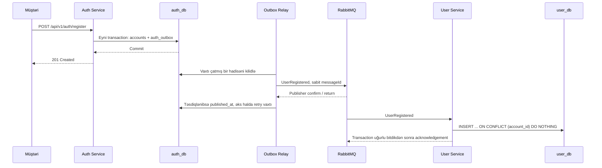

# İlk mərhələ: etibarlı qeydiyyat

Bu mərhələ mövcud Auth → RabbitMQ → User axınını etibarlı edir.
Yeni API endpoint əlavə etmir; kurs, stok və ödəniş servisləri sonrakı mərhələlərdir.

## Axın



`201 Created` hesabın saxlandığını bildirir. Profil asinxron yaranır və həmin anda
hələ hazır olmaya bilər. Qeydiyyat zamanı RabbitMQ-ya qoşulmaq tələb olunmur.

## Dəyişən hissələr

- `UserEventPublisher`: xəbəri birbaşa brokerə göndərmək əvəzinə `auth_outbox`
  cədvəlinə yazır. Aktiv transaction tələb edir; qeydiyyat geri qaytarılsa hadisə də geri qaytarılır.
- `OutboxRelay`: PostgreSQL-də `FOR UPDATE SKIP LOCKED` ilə bir hadisə seçir.
  Paralel Auth instansiyaları həmin qeydi eyni anda götürmür.
- `OutboxScheduler`: hər 2 saniyədən bir maksimum 20 hadisə göndərməyə çalışır.
  Xəta olduqda cari dövrü dayandırır. Növbəti cəhdlər 5 saniyədən başlayır və
  maksimum 5 dəqiqəyə qədər artır. Göndərilməyən qeyd bazada qalır.
- Publisher confirms, mandatory returns və persistent mesajlar aktivdir.
  Təkcə broker ACK-i kifayət etmir: mesaj heç bir növbəyə çatmayıbsa pending qalır.
- Profil yaradılması `account_id` üzrə atomikdir. Eyni hadisənin paralel və ya
  təkrar çatdırılması ikinci profil yaratmır. Başqa hesaba aid email konflikti gizlədilmir.
- User consumer maksimum 3 emal cəhdi edir. Həll olunmayan mesaj mövcud
  `user-service.user-registered.dlq` növbəsinə yönləndirilir.

Bu, ən azı bir dəfə çatdırılma modelidir. Broker mesajı qəbul etdikdən sonra Auth
prosesi DB commit-dən əvvəl dayansa, mesaj yenidən göndərilə bilər. Buna görə
consumer-in təkrar emala davamlı olması vacibdir.

Relay bu ilk versiyada broker təsdiqini gözləyərkən yalnız seçilmiş outbox sətrinin
kilidini saxlayır. Təsdiq gözləməsi standart olaraq 5 saniyədir; əlaqə qurulmasının
ayrıca timeout-u var. Daha yüksək yükdə qısa transaction ilə lease/claim mexanizmi
qiymətləndirilə bilər. Bu mərhələdə hadisə sıralanmasına zəmanət verilmir;
UserRegistered axını sıralanmadan asılı deyil.

## Özün yoxla

Lokal bazalar, Eureka, User, Auth və Gateway işləsin. İlk başladılmada User servisinin
növbə və binding-ləri yaratdığını yoxla. Mövcud lokal konfiqurasiya və giriş məlumatlarından istifadə et.

1. Yeni email ilə `/api/v1/auth/register` çağır. `accounts` və `users` qeydlərinin yarandığını yoxla.
2. `docker compose stop rabbitmq` ilə brokeri dayandır.
3. Başqa yeni email ilə qeydiyyat et. Hesab yaranmalı və outbox-da `published_at IS NULL` qalmalıdır.
4. `docker compose start rabbitmq` ilə brokeri bərpa et. Retry vaxtı çatanda profil yaranmalıdır.
5. Eyni `UserRegistered` payload-ını yenidən çatdır. Eyni `account_id` üçün yalnız bir profil qalmalıdır.

Auth bazasında:

```sql
SELECT id, created_at, next_attempt_at, published_at, attempts
FROM auth_outbox
ORDER BY created_at DESC;
```

User bazasında:

```sql
SELECT account_id, COUNT(*)
FROM users
GROUP BY account_id
HAVING COUNT(*) > 1;
```

İkinci sorğu nəticə qaytarmamalıdır. Outbox payload-ında şəxsi məlumat var;
onu tətbiq loglarına çıxarmırıq. Göndərilmiş qeydlər üçün saxlanma/təmizləmə siyasəti
production mərhələsində ayrıca təyin edilməlidir.

## Avtomatik testlər

JDK 21 və Gradle wrapper ilə layihənin kökündən:

```powershell
.\gradlew.bat :auth-service:test --tests '*Outbox*Test' :user-service:test --tests '*UserProfileDeliveryTest'
```

- `OutboxRelayTest`: ACK, NACK, yönləndirilməyən mesaj, broker xətası və timeout.
  RabbitMQ imitasiya olunur; işləyən broker tələb etmir.
- `OutboxPersistenceTest`: real PostgreSQL-də account/outbox rollback və pending hadisənin seçilməsi.
- `UserProfileDeliveryTest`: real PostgreSQL-də paralel təkrar çatdırılma və email konflikti.

Son iki sinif Testcontainers istifadə edir; Docker işləmədikdə skip olunur.
Bu testlər RabbitMQ ilə tam end-to-end yoxlamanı əvəz etmir; yuxarıdakı lokal
sınaq brokerin dayanma/bərpa axınını yoxlamaq üçündür.

Hazırkı layihənin `ddl-auto: update` ayarı lokal development üçün yeni outbox
cədvəlini yaradır. Production üçün versiyalanmış DB migration-ları ayrıca hazırlanmalıdır.

## Mənbə

Publisher confirm və return davranışı: [Spring AMQP](https://docs.spring.io/spring-amqp/reference/amqp/template.html).
